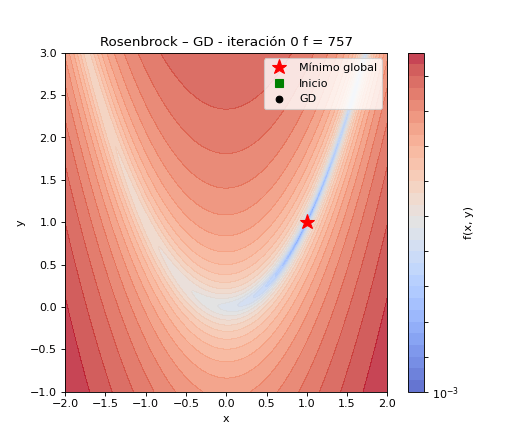
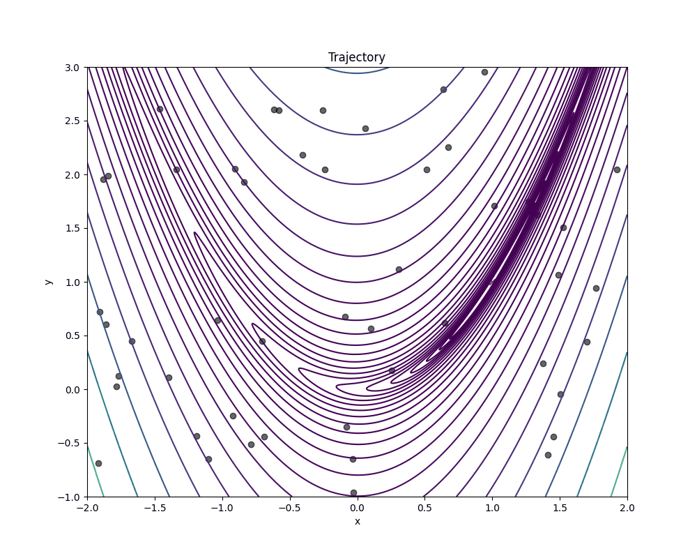
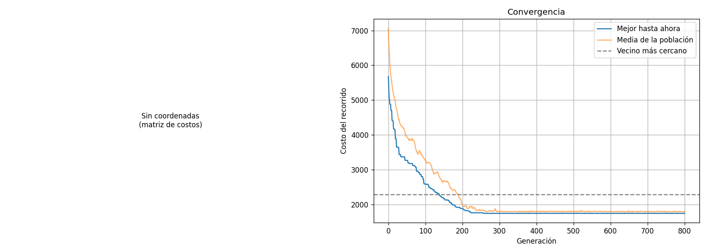
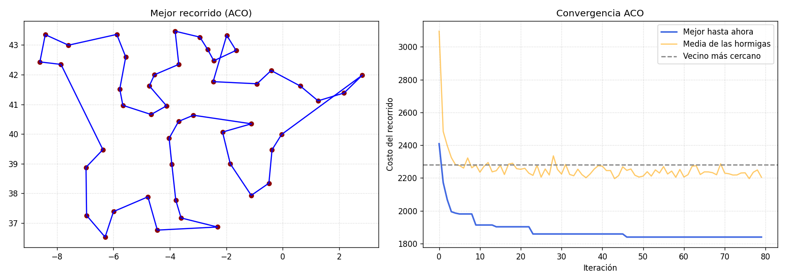
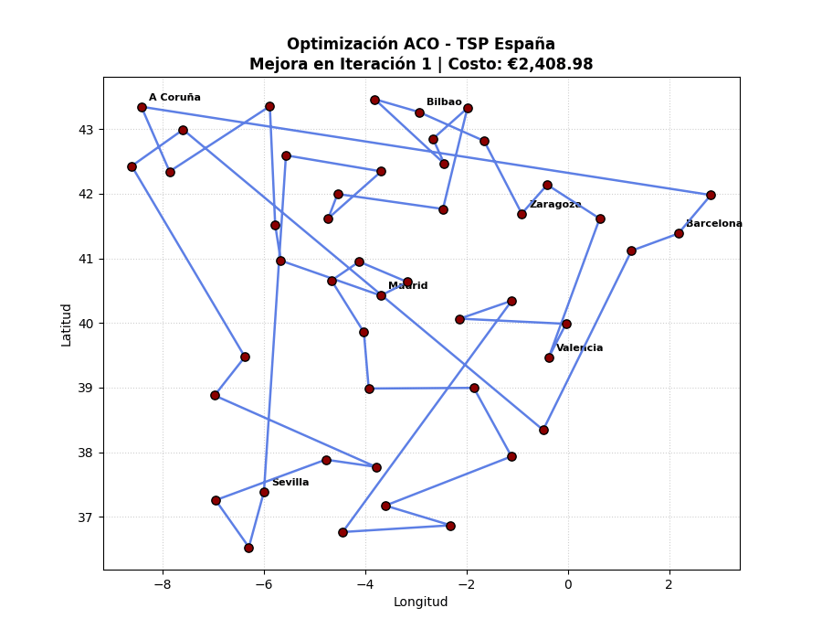
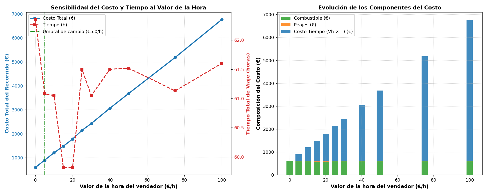

# Optimización numérica, metaheurística y combinatoria: del gradiente a las hormigas recorriendo España

**Trabajo 1 · Redes neuronales y algoritmos bioinspirados · Universidad Nacional de Colombia, Facultad de Minas · 2026-02**

**Equipo:** Tomás Gómez Cardona (P1), Sebastián Ocampo Galvis (P2), Juan Felipe Miranda Arciniegas (P3), Ana Sofía Gómez Zapata (P4), Juan José Baena García (P5).

**Repositorio:** https://github.com/angomezz/RedesNeuronales_Trabajo1
**Videos de contribución individual:** https://canva.link/m3tak8meiaeh9ky

---

## Resumen

Comparamos el descenso por gradiente con tres metaheurísticas (algoritmo evolutivo, enjambre de partículas y evolución diferencial) sobre las funciones de Rosenbrock y Schwefel en 2 y 3 dimensiones, con 30 corridas por configuración y contando por separado las evaluaciones de $f$ y de $\nabla f$. Después aplicamos colonias de hormigas y un algoritmo genético a un problema real: recorrer en carro las 47 capitales de provincia de la España peninsular al menor costo, sumando tiempo del vendedor, peajes y combustible. Todo se reproduce desde el repositorio con un solo comando por experimento.

---

## Parte 1: Optimización numérica

### 1.1 Funciones de prueba

Escogimos dos funciones con geometrías muy distintas (Tabla 1). Su código está en `src/parte1/funciones.py`.

**Rosenbrock** (Rosenbrock, 1960):

$$
f(\mathbf{x}) = \sum_{i=1}^{n-1}\left[100\,(x_{i+1}-x_i^2)^2 + (1-x_i)^2\right]
$$

Tiene un valle curvo, largo y muy angosto. En 2 y 3 dimensiones el único mínimo está en $(1,\dots,1)$, pero el valle está muy mal condicionado: es empinado hacia los lados y casi plano a lo largo.

**Schwefel** (Schwefel, 1981):

$$
f(\mathbf{x}) = 418.9829\,n - \sum_{i=1}^{n} x_i \sin\!\left(\sqrt{|x_i|}\right)
$$

Es una suma de un término por coordenada (separable) con muchísimos mínimos locales. El mínimo global está cerca del borde del dominio, en $x_i \approx 420.9687$, y el segundo mejor mínimo de cada coordenada está en el lado opuesto, en $x_i \approx -302.52$.

**Tabla 1.** *Funciones de prueba usadas.*

| Función | Dominio usado | Mínimo global | Valor mínimo | Geometría |
|---|---|---|---|---|
| Rosenbrock | $[-2, 2]^n$ | $(1, \dots, 1)$ | 0 | Un mínimo, valle curvo mal condicionado |
| Schwefel | $[-500, 500]^n$ | $(420.9687, \dots, 420.9687)$ | $\approx 0$ | Separable, muchos mínimos locales, óptimo cerca del borde |

*Fuente:* elaboración propia.

### 1.2 Métodos

**Descenso por gradiente (GD).** Parte de un punto aleatorio del dominio y da pasos en la dirección contraria al gradiente:

$$
\mathbf{x}_{t+1} = \mathbf{x}_t - \eta\,\nabla f(\mathbf{x}_t)
$$

Usamos gradientes analíticos y paramos tras 2000 iteraciones o cuando el paso es menor que $10^{-5}$. La tasa de aprendizaje es $\eta = 10^{-5}$ en Rosenbrock (más grande diverge en la pared del valle) y $\eta = 0.1$ en Schwefel. Código: `src/parte1/gradiente.py`.

**Algoritmo evolutivo (EA).** Población de 50 individuos durante 100 generaciones. En cada generación se ordena la población por su valor de $f$ y la siguiente se forma con: el 15 % mejor (elitismo), un 10 % de mutantes (a una coordenada al azar se le suma ruido gaussiano con la desviación estándar de la población en esa coordenada) y un 75 % de hijos por cruce de un punto. Código: `src/parte1/heuristicas.py`.

**Optimización por enjambre de partículas (PSO)** (Kennedy y Eberhart, 1995; Shi y Eberhart, 1998). Cada partícula combina su inercia, la atracción a su mejor punto $\mathbf{p}_i$ y la atracción al mejor del grupo $\mathbf{g}$:

$$
\mathbf{v}_i(t+1) = w\,\mathbf{v}_i(t) + c_1\mathbf{r}_1 \odot (\mathbf{p}_i - \mathbf{x}_i(t)) + c_2\mathbf{r}_2 \odot (\mathbf{g} - \mathbf{x}_i(t)), \qquad \mathbf{x}_i(t+1) = \mathbf{x}_i(t) + \mathbf{v}_i(t+1)
$$

Usamos la clase `GlobalBestPSO` de PySwarms (Miranda, 2018) con 50 partículas, 100 iteraciones, $w = 0.9$, $c_1 = 0.5$ y $c_2 = 0.3$. Revisamos su código: si una partícula sale del dominio vuelve a entrar por el lado contrario (bordes periódicos) y no hay velocidad máxima. El detalle completo está en `docs/reporte_p3_pso.md`.

**Evolución diferencial (DE)** (Storn y Price, 1997). Para cada individuo $\mathbf{x}_i$ se crea un mutante con el mejor individuo y la diferencia de otros dos, se cruza componente a componente y se queda con el mejor:

$$
\mathbf{v}_i = \mathbf{x}_{\text{mejor}} + F\,(\mathbf{x}_{r_1} - \mathbf{x}_{r_2}), \qquad
u_{ij} = \begin{cases} v_{ij} & \text{si } r_j < CR \\ x_{ij} & \text{si no} \end{cases}, \qquad
\mathbf{x}_i \leftarrow \begin{cases} \mathbf{u}_i & \text{si } f(\mathbf{u}_i) \le f(\mathbf{x}_i) \\ \mathbf{x}_i & \text{si no} \end{cases}
$$

Usamos `scipy.optimize.differential_evolution` (Virtanen et al., 2020) con su estrategia por defecto (`best1bin`, $F$ aleatorio entre 0.5 y 1, $CR = 0.7$), población de $15n$, hasta 200 generaciones y tolerancia $10^{-6}$. Ojo: por defecto SciPy termina con un pulido local (L-BFGS-B); sus evaluaciones de $f$ sí quedan contadas.

### 1.3 Comparación justa

Contamos por separado las evaluaciones de $f$ y de $\nabla f$ con contadores que suman uno en cada llamada. Para comparar usamos la equivalencia del enunciado: **una evaluación de $\nabla f$ en dimensión $n$ cuesta $2n$ evaluaciones de $f$** (diferencias centrales). Hicimos 30 corridas por configuración (semillas 56 a 85) y contamos una corrida como exitosa si terminó con $f \le 10^{-2}$.

```bash
python -m src.parte1.main --modo arnes --runs 30
```

### 1.4 Resultados

**Tabla 2.** *Rosenbrock: 30 corridas por configuración.*

| Método | $n$ | Media | Desv. est. | Mejor | Peor | Éxito | Evals. $f$ | Evals. $\nabla f$ | Evals. equivalentes |
|---|---|---|---|---|---|---|---|---|---|
| GD | 2 | 1.24 | 1.30 | $6.5\times10^{-4}$ | 4.54 | 6.7 % | 1 | 1556 | 6 225 |
| PSO | 2 | $1.4\times10^{-4}$ | $4.5\times10^{-4}$ | $\approx 0$ | $2.1\times10^{-3}$ | 100 % | 5000 | 0 | 5 000 |
| EA | 2 | 0.052 | 0.067 | $1.6\times10^{-4}$ | 0.244 | 30.0 % | 5050 | 0 | 5 050 |
| DE | 2 | $\approx 0$ | $\approx 0$ | $\approx 0$ | $\approx 0$ | 100 % | 4041 | 0 | 4 041 |
| GD | 3 | 3.89 | 7.11 | $2.8\times10^{-3}$ | 35.43 | 10.0 % | 1 | 1822 | 10 936 |
| PSO | 3 | 0.064 | 0.086 | $4.9\times10^{-4}$ | 0.389 | 30.0 % | 5000 | 0 | 5 000 |
| EA | 3 | 0.458 | 0.422 | $4.4\times10^{-3}$ | 1.446 | 10.0 % | 5050 | 0 | 5 050 |
| DE | 3 | $\approx 0$ | $\approx 0$ | $\approx 0$ | $\approx 0$ | 100 % | 9049 | 0 | 9 049 |

*Fuente:* elaboración propia, `python -m src.parte1.main --modo arnes`. Desviación estándar poblacional. Evaluaciones equivalentes $= \text{evals. } f + 2n \cdot \text{evals. } \nabla f$.

**Tabla 3.** *Schwefel: 30 corridas por configuración.*

| Método | $n$ | Media | Desv. est. | Mejor | Peor | Éxito | Evals. $f$ | Evals. $\nabla f$ | Evals. equivalentes |
|---|---|---|---|---|---|---|---|---|---|
| GD | 2 | 313.94 | 221.57 | −138.18 * | 710.70 | 6.7 % * | 1 | 497 | 1 990 |
| PSO | 2 | 0.433 | 2.004 | $2.7\times10^{-5}$ | 11.19 | 56.7 % | 5000 | 0 | 5 000 |
| EA | 2 | 3.95 | 21.26 | $2.5\times10^{-5}$ | 118.44 | 96.7 % | 5050 | 0 | 5 050 |
| DE | 2 | 7.90 | 29.54 | $2.5\times10^{-5}$ | 118.44 | 93.3 % | 1454 | 0 | 1 454 |
| GD | 3 | 448.87 | 287.52 | −138.18 * | 829.58 | 0.0 % | 1 | 519 | 3 115 |
| PSO | 3 | 61.75 | 69.62 | $6.6\times10^{-4}$ | 217.53 | 6.7 % | 5000 | 0 | 5 000 |
| EA | 3 | 38.09 | 54.35 | $4.4\times10^{-5}$ | 118.44 | 63.3 % | 5050 | 0 | 5 050 |
| DE | 3 | 3.95 | 21.26 | $3.8\times10^{-5}$ | 118.44 | 96.7 % | 3106 | 0 | 3 106 |

*Fuente:* elaboración propia, `python -m src.parte1.main --modo arnes`. \* Valores negativos: GD salió del dominio $[-500, 500]^n$, donde Schwefel toma valores menores que su mínimo global; esos puntos no son soluciones válidas.

La Figura 1 muestra el descenso por gradiente en Rosenbrock y la Figura 2, el enjambre de PSO.

**Figura 1.** *Descenso por gradiente sobre Rosenbrock (2D).*



*Fuente:* elaboración propia, `python -m src.parte1.main --modo gif` ($\eta = 0.001$, 20 000 iteraciones, semilla 56).

**Figura 2.** *Enjambre de PSO sobre Rosenbrock (2D).*



*Fuente:* elaboración propia, `python -m src.parte1.main --modo gif` (50 partículas, 100 iteraciones, semilla 56).

### 1.5 Discusión de la Parte 1

**Rosenbrock: el problema es el condicionamiento, no los mínimos locales.** La función tiene un solo mínimo, así que en principio el gradiente debería bastar. Pero el valle es tan angosto que la tasa de aprendizaje tiene que ser muy pequeña para no rebotar en sus paredes, y con pasos tan cortos GD avanza muy lento a lo largo del valle (Figura 1): con unas 6 000 evaluaciones equivalentes solo el 6.7 % de las corridas llegó al umbral en 2D. Las metaheurísticas, que no dependen del gradiente, lo hicieron mucho mejor con un presupuesto parecido: DE resolvió el 100 % de las corridas en 2D y 3D, y PSO el 100 % en 2D (Tabla 2). En 3D, PSO y EA encuentran el valle pero no les alcanzan las evaluaciones para llegar al fondo.

**Schwefel: el problema son los mínimos locales.** Aquí GD aporta poco: solo puede bajar al mínimo local más cercano al punto donde empieza, y con $\eta = 0.1$ además se sale del dominio, lo que produce valores "mejores que el óptimo" que no son válidos (Tabla 3). Las metaheurísticas exploran todo el dominio y casi siempre encuentran la zona correcta. Sus fallas tienen una firma muy clara: el peor valor es exactamente 118.44 o un múltiplo, que corresponde a una coordenada atrapada en el segundo mejor mínimo ($x_i \approx -302.52$). Como la función es separable, al pasar de 2 a 3 dimensiones crece la probabilidad de que alguna coordenada quede atrapada, y la tasa de éxito baja en todos los métodos. DE fue el más robusto (93–97 %); PSO, con $w = 0.9$ y coeficientes bajos, llegó a la zona correcta pero muchas veces no terminó de afinar.

**¿Qué aportó cada familia?** El gradiente es muy eficiente cuando la función es suave, convexa cerca del óptimo y bien condicionada, porque usa información local exacta. Pero falla en funciones mal condicionadas (pasos pequeños) y multimodales (se queda en el primer mínimo). Las metaheurísticas gastan miles de evaluaciones de $f$, pero no necesitan gradiente, exploran globalmente y fueron las únicas que resolvieron Schwefel de forma confiable.

---

## Parte 2: Optimización combinatoria

### 2.1 Formulación del problema del viajero

Un vendedor debe pasar una vez por cada una de las $N = 47$ capitales y volver a la de salida. Un recorrido es una permutación $\pi$ de las ciudades y su costo es

$$
f(\pi) = \sum_{k=0}^{N-2} C_{\pi(k),\,\pi(k+1)} + C_{\pi(N-1),\,\pi(0)}, \qquad \min_{\pi \in S_N} f(\pi).
$$

Como el costo es simétrico, hay $(N-1)!/2 = 46!/2 \approx 2.75 \times 10^{57}$ recorridos distintos: no se pueden probar todos. Detalle en `docs/reporte_p3_formulacion_tsp.md`.

### 2.2 Costo de cada trayecto y datos

$$
C_{ij}(V_h) = V_h\,T_{ij} + P_{ij} + D_{ij}\,\frac{c}{100}\,p
$$

**Tabla 4.** *Componentes del costo.*

| Componente | Cómo se obtuvo | Fuente |
|---|---|---|
| Coordenadas | Nominatim (OpenStreetMap), respuestas en `data/raw/` | OpenStreetMap, consulta 13/10/2026 |
| Distancia $D_{ij}$ | Línea recta (Haversine) × 1.28 | Aproximación del equipo |
| Tiempo $T_{ij}$ | $D_{ij}$ / 105 km/h | Velocidad promedio fija |
| Peajes $P_{ij}$ | 8 pares con peaje (AP-68, AP-66, AP-6, AP-71, AP-46) | Ver `data/SOURCES.md` |
| Vehículo | SEAT León 1.5 TSI 130 CV, $c = 5.6$ L/100 km (WLTP) | Ficha técnica de SEAT; km77 |
| Combustible | Gasolina 95, $p = 1.62$ €/L | Ver limitaciones |

*Fuente:* elaboración propia; enlaces y fechas en `data/SOURCES.md`.

**Limitaciones que reconocemos.** Las distancias no son por carretera; el tiempo es proporcional a la distancia, así que $V_h$ solo cambia cuánto pesa la distancia frente a los peajes; faltan autopistas con peaje (por ejemplo, la AP-7 Alicante–Cartagena); y el precio de la gasolina está desactualizado (era 1.857 €/L el 1 de octubre de 2026). Varias autopistas ya no cobran porque terminó su concesión: AP-1 (2018), AP-7 Tarragona–Alicante y AP-4 (2020), AP-2 y AP-7 Tarragona–La Jonquera (2021).

### 2.3 Colonias de hormigas (ACO)

Implementamos un sistema de hormigas elitista (Dorigo et al., 1996; Dorigo y Stützle, 2004). Cada hormiga construye un recorrido eligiendo la siguiente ciudad $j$ con probabilidad

$$
p_{ij} = \frac{\tau_{ij}^{\alpha}\,\eta_{ij}^{\beta}}{\sum_{l \in \text{no visitadas}} \tau_{il}^{\alpha}\,\eta_{il}^{\beta}}, \qquad \eta_{ij} = \frac{1}{C_{ij}}.
$$

Al final de cada iteración la feromona se evapora y cada hormiga deposita según la calidad de su recorrido, con un refuerzo extra para el mejor recorrido global $\pi^*$:

$$
\tau_{ij} \leftarrow (1-\rho)\,\tau_{ij} + \sum_{k=1}^{m} \frac{Q}{f(\pi_k)}\,[\,(i,j) \in \pi_k\,] + e\,\frac{Q}{f(\pi^*)}\,[\,(i,j) \in \pi^*\,].
$$

Parámetros: $m = 47$ hormigas, 80 iteraciones, $\alpha = 1$, $\beta = 3$, $\rho = 0.1$, $Q = 100$, $e = 2$. Cada hormiga es una evaluación: 3 760 por corrida. Código: `src/parte2/aco_tsp.py`.

### 2.4 Algoritmo genético (GA)

Cada individuo es una permutación. Usamos selección por torneo ($k = 3$), cruce de orden OX ($p_c = 0.9$), que copia un tramo de un padre y completa con el orden del otro sin repetir ciudades, mutación por inversión de un tramo ($p_m = 0.2$, equivale a un movimiento 2-opt) y elitismo de 2 individuos. Con 300 individuos y 800 generaciones hace $300 + 298 \times 800 = 238\,700$ evaluaciones. Código: `src/parte2/ga_tsp.py`; detalle en `docs/reporte_p4.md`.

### 2.5 Resultados con $V_h = 20$ €/h

**Tabla 5.** *ACO y GA en 30 corridas (costo del recorrido en euros).*

| Método | Mejor | Peor | Media | Desv. est. | Éxito (≤ 3 % del mejor propio) | Evals. por corrida |
|---|---|---|---|---|---|---|
| ACO | 1816.70 | 1864.91 | 1838.25 | 11.16 | 100 % | 3 760 |
| GA | 1740.88 | 1911.16 | 1821.85 | 36.80 | 16.7 % | 238 700 |
| Vecino más cercano | 2279.78 | — | — | — | — | — |

*Fuente:* elaboración propia, `PYTHONPATH=src/parte2 python src/parte2/benchmark_aco_30.py --hourly-value 20.0` y `python src/parte2/benchmark_ga_30.py`.

Las dos metaheurísticas mejoran en torno a un 20 % la heurística del vecino más cercano. El GA encontró el mejor recorrido (1740.88 €) y tiene mejor media, pero es mucho más variable y usó 63 veces más evaluaciones. El ACO es muy estable: todas sus corridas quedan en un rango de 48 €. Con el mismo presupuesto de evaluaciones la comparación podría cambiar. Las Figuras 3 y 4 muestran la convergencia de cada método, y la Figura 5, cómo mejora el recorrido del ACO.

**Figura 3.** *Convergencia del GA (mejor de la población y media), semilla 12.*



*Fuente:* elaboración propia, `python src/parte2/ga_tsp.py --matrix data/cost_matrix.csv --pop 300 --gens 800 --seed 12 --no-show`.

**Figura 4.** *Mejor recorrido del ACO y su convergencia.*



*Fuente:* elaboración propia, `python src/parte2/aco_tsp.py --matrix data/cost_matrix.csv --coords data/coordinates.csv --ants 47 --iters 80 --gif --no-show`.

**Figura 5.** *Evolución del mejor recorrido del ACO sobre las coordenadas de las 47 capitales (longitud y latitud).*



*Fuente:* elaboración propia, mismo comando de la Figura 4.

### 2.6 ¿Cambia la ruta con el valor de la hora?

Repetimos el ACO (mejor de 3 semillas) con $V_h$ entre 0 y 100 €/h (Tabla 6 y Figura 6).

**Tabla 6.** *Mejor recorrido encontrado según el valor de la hora.*

| $V_h$ (€/h) | 0 | 5 | 10 | 15 | 20 | 25 | 30 | 40 | 50 | 75 | 100 |
|---|---|---|---|---|---|---|---|---|---|---|---|
| Distancia (km) | 6547 | 6414 | 6410 | 6281 | 6281 | 6457 | 6410 | 6457 | 6459 | 6418 | 6468 |
| Peajes (€) | 0.00 | 14.30 | 14.30 | 14.30 | 14.30 | 19.70 | 14.30 | 19.70 | 14.30 | 14.30 | 14.30 |

*Fuente:* elaboración propia, `PYTHONPATH=src/parte2 python src/parte2/study_hourly_value.py --no-show`.

**Figura 6.** *Costo total, tiempo y composición del costo según el valor de la hora.*



*Fuente:* elaboración propia, mismo comando de la Tabla 6.

**Interpretación.** Sí cambia, y el cambio claro ocurre **entre 0 y 5 €/h**: si el tiempo no vale nada, la ruta evita todos los peajes (6547 km, 0 €); en cuanto el tiempo tiene algún valor, conviene pagar la AP-66 entre León y Oviedo (14.30 €) para acortar el recorrido. Para valores mayores, la teoría dice que la distancia solo debería bajar o quedarse igual, porque en nuestro modelo el tiempo es proporcional a la distancia. Sin embargo, en la Tabla 6 sube y baja sin orden. Eso no es un cambio real de ruta, sino la variabilidad del ACO, que no siempre encuentra el óptimo. Para afirmar más cambios haría falta un método exacto o muchas más corridas, y datos de tiempo reales por tipo de vía.

---

## Uso de inteligencia artificial

Usamos Claude, ChatGPT, Gemini y GitHub Copilot como apoyo para escribir y depurar código, redactar y buscar referencias, y verificamos lo que entregaron antes de usarlo. Fueron útiles para el código base y la depuración, y poco confiables en datos del mundo real (peajes y precios desactualizados), en números calculados de memoria y en detalles de referencias. Los principales prompts de cada integrante y su impacto están en `docs/uso_de_ia.md`.

## Cacería de la alucinación

Documentamos 7 hallazgos que cubren cuatro de las cinco categorías del enunciado: código, conceptos, datos del mundo real y bibliografía (Tabla 7). Cada uno tiene el prompt literal, la respuesta, cómo se sospechó, la evidencia, la corrección y la lección.

**Tabla 7.** *Hallazgos de la cacería de la alucinación.*

| Integrante | Categoría | Hallazgo | Archivo |
|---|---|---|---|
| P1 | Código | Conteo ambiguo de evaluaciones en código de PSO generado por IA | `docs/caceria_alucinacion_p1.md` |
| P1 | Código | Formato invertido de los límites en la animación de PySwarms | `docs/caceria_alucinacion_p1.md` |
| P2 | Código | Corrección sobredimensionada de un error en la animación del PSO | `docs/caceria_alucinacion_p2.md` |
| P3 | Bibliografía | Referencia real con un autor mal escrito ("Abeda, H. E." en vez de "El Abed, H.") | `docs/caceria_alucinacion_p3.md` |
| P4 | Datos del mundo real | Precio de la gasolina 95 en España muy desactualizado | `docs/caceria_alucinacion_p4.md` |
| P5 | Conceptos / código | Evaporación de feromona aplicada con $\rho$ en lugar de $(1-\rho)$ | `docs/caceria_alucinacion_p5.md` |
| P5 | Datos del mundo real | Peajes de la AP-7 y la AP-2 que ya no existen | `docs/caceria_alucinacion_p5.md` |

*Fuente:* elaboración propia.

---

## Referencias

Dorigo, M., Maniezzo, V., & Colorni, A. (1996). Ant system: Optimization by a colony of cooperating agents. *IEEE Transactions on Systems, Man, and Cybernetics, Part B (Cybernetics), 26*(1), 29–41. https://doi.org/10.1109/3477.484436

Dorigo, M., & Stützle, T. (2004). *Ant colony optimization*. MIT Press. https://doi.org/10.7551/mitpress/1290.001.0001

Kennedy, J., & Eberhart, R. (1995). Particle swarm optimization. En *Proceedings of ICNN'95 – International Conference on Neural Networks* (Vol. 4, pp. 1942–1948). IEEE. https://doi.org/10.1109/ICNN.1995.488968

Miranda, L. J. V. (2018). PySwarms: A research toolkit for particle swarm optimization in Python. *Journal of Open Source Software, 3*(21), 433. https://doi.org/10.21105/joss.00433

Rosenbrock, H. H. (1960). An automatic method for finding the greatest or least value of a function. *The Computer Journal, 3*(3), 175–184. https://doi.org/10.1093/comjnl/3.3.175

Schwefel, H.-P. (1981). *Numerical optimization of computer models*. Wiley.

Shi, Y., & Eberhart, R. (1998). A modified particle swarm optimizer. En *1998 IEEE International Conference on Evolutionary Computation Proceedings* (pp. 69–73). IEEE. https://doi.org/10.1109/ICEC.1998.699146

Storn, R., & Price, K. (1997). Differential evolution – A simple and efficient heuristic for global optimization over continuous spaces. *Journal of Global Optimization, 11*(4), 341–359. https://doi.org/10.1023/A:1008202821328

Virtanen, P., Gommers, R., Oliphant, T. E., et al. (2020). SciPy 1.0: Fundamental algorithms for scientific computing in Python. *Nature Methods, 17*(3), 261–272. https://doi.org/10.1038/s41592-019-0686-2
